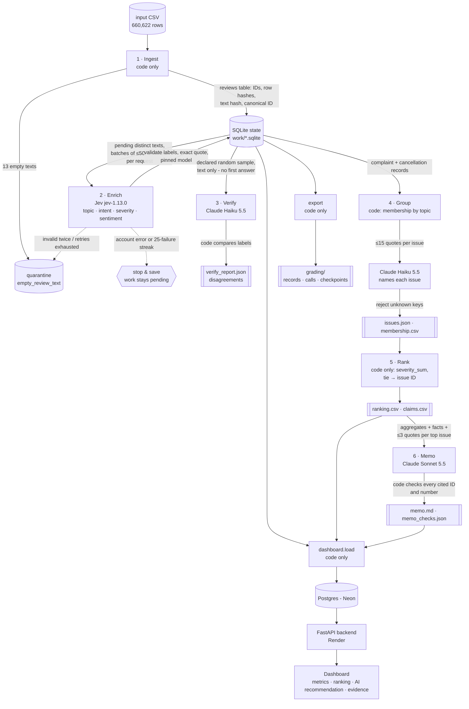

# Architecture

Six stages run under one orchestrator ([`pipeline/run.py`](../pipeline/run.py)). **Code** owns record
accounting, deduplication, validation, retries, budgets, arithmetic and ordering. **Models** only read
messy language: Jev classifies, Claude Haiku verifies and names issues, Claude Sonnet writes the memo.
Every stage saves its handoff (SQLite state + files) before the next stage starts.

## Roles

| Stage | Owner | Input | Output | Failure behaviour | Stop condition |
|---|---|---|---|---|---|
| Ingest | code | CSV path | `reviews`, `quarantine`, `meta` tables; `ingestion_report.json` | duplicate ID aborts | all rows read |
| Enrich | Jev (`jev-1.13.0`, Choice + Score) | one distinct text per request, ≤50 per batch | `results` + `calls` rows, committed per review | 429/5xx/timeout: ≤4 attempts, exponential backoff + jitter; invalid output: 1 retry then quarantine; account error or 25 consecutive failed reviews: stop, leave pending | queue empty, token cap, provider stop, or planned interruption |
| Verify | Claude Haiku 5.5, effort low | declared hash-seeded random sample, ≤25 reviews/request, text + rubric only | `verifications` rows, `verify_report.json` | returned keys must equal sent keys (1 retry) | sample verified or USD cap |
| Group | code + Claude Haiku 5.5 | complaint/cancellation records; ≤15 quotes per issue | `membership`, `issues`; names cached by pack hash | unknown representative keys rejected | all issues named |
| Rank | code | records + membership | `ranking.csv`, `claims.csv` | — | deterministic |
| Memo | Claude Sonnet 5.5, effort medium | ranking, claims, facts, ≤3 quotes per top issue | `memo.md`, `memo_checks.json`; cached by input hash | unknown IDs → 1 retry; numbers not in claims/facts listed for human review | one memo |

## Why each model call exists, and what code does instead

* **Jev** answers four fixed-choice questions per review. Fixed options suit a classifier, and its
  per-option probabilities give a `needs_review` signal without another model. Quotes and entities are
  extracted by code, so no model is paid to copy text.
* **Claude Haiku (verify)** is a *different* model family re-labelling a sample blind, so agreement is
  an independent check rather than self-consistency.
* **Claude Haiku (group)** only writes human-readable issue names from bounded examples; membership,
  counts and IDs come from code.
* **Claude Sonnet (memo)** writes one argument from aggregates. It never sees raw data; code verifies
  every cited claim, fact, issue and review ID.
* Ingestion, deduplication (484,189 distinct texts serve 660,609 nonempty rows), counting, ranking,
  claims, exports and the dashboard data are all code - no model call.

## Caching and recovery

* **Result cache**: key = exact text SHA-256 + `label_config`. Duplicate texts get `cache_source_id`
  pointing at the review whose call produced the labels. Changing the prompt version changes the key.
* **Downstream cache**: group names and the memo are stored in `artifacts` keyed by their input hash and
  config; an unchanged rerun makes zero calls (pilot warm run: 0 calls at every stage).
* **Resume**: pending = distinct texts with no result under the current `label_config`. Each finished
  review commits its result with its call log, so an interruption loses at most in-flight calls.
* **Budgets**: Jev token cap and Anthropic USD cap; worst-case usage is reserved before each call and
  no call is admitted once spent + reserved + next reservation exceeds the cap.
